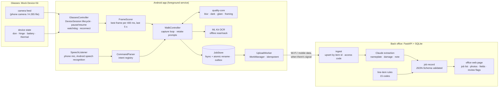

# FieldCapture

**Hands-free field capture on AI glasses.** A technician walks a damaged home wearing Meta glasses and never touches the phone. They say *"capture nameplate"*, *"capture damage, kitchen, north wall"* or *"note: subfloor soft by the cabinet"*. When they walk out, the office opens a web page and finds the job record: usable evidence, extracted fields with confidence scores, draft estimate line items, and a list of what needs a human.

Built on **Meta Wearables Device Access Toolkit (DAT) 1.1.0** for Android. It runs on **Mock Device Kit**, which uses the phone's camera as the glasses camera, so no glasses are needed.

**Demo video (4:48):** https://www.youtube.com/watch?v=JIp_C6zVdfw. It shows one walk in a real home, recorded on the `demo-v1` APK. It includes two caught failures:
- Too dark → "Turn on your light" → the light goes on → the capture is accepted by itself.
- The glasses are powered off mid-walk → notes still work → "Glasses back".

It ends with the job in the office web page.

**Submitted build:** tag [`demo-v1`](../../releases/tag/demo-v1) (APK attached). Every number below comes from a committed script and committed data: [eval/REPORT.md](eval/REPORT.md). How we got here, decision by decision: [docs/JOURNAL.md](docs/JOURNAL.md). One-page research memo: [docs/MEMO.md](docs/MEMO.md).

## Results at a glance

| | Measured | Where |
|---|---|---|
| Test set | **204 frames** (3 per capture, committed) from **68 captures of 22 real scenes**: 13 plate labels on 11 appliances, 9 damage spots, **80 low-light frames**. 11 captures left out for privacy. | [REPORT §1](eval/REPORT.md) |
| Quality gate, held-out scenes | Catches **75%** of bad frames (seed thresholds: 68%). Asks for a retake on **20%** of usable frames, which is too many; why is in the journal. | REPORT §2 |
| Plates (Opus 5.5) | When it answers, it's right **92%** of the time. It invents a value for **0 of 330** fields that aren't printed. It reads **120 of 280** printed fields exactly; most misses are blanks, not wrong values. | REPORT §3–4 |
| Confidence | The shipped confidence lets **1 of 11** wrong plate values through without review (the earlier priors: 6 of 11). | REPORT §4 |
| Notes → fields | Category **18/18** on every model; location 72–83%. | REPORT §7 |
| Size without depth (stretch) | **Not usable:** median area error **255%** against a ruler. Every size is sent as "measure". | REPORT §6 |
| A torch in the dark (same 8 plates) | Gate passes **22% → 79%** of frames; what Opus reads is unchanged (42% → 40%). This is the memo's hardware call. | [`eval/torch_pairs.py`](eval/torch_pairs.py) |
| Nothing lost | Back office down 60 s, app killed, glasses off mid-walk: the server holds exactly what the phone acknowledged (5 captures, 3 notes), none twice. | [`eval/chaos/`](eval/chaos/) |
| Cost and latency (stretch) | **$0.016 per photo** (Opus), $0.0002 per note (Haiku); about **$0.19 per typical job**. Real walks: $0.07–$0.10. Opus p50 4.6 s per photo. | REPORT §8, [samples/](samples/README.md) |
| Sample output | **3 job records from real walk-throughs**, uploaded over Wi-Fi with no cable. | [samples/](samples/README.md) |

## Architecture



## Setup (under 10 minutes)

**You need:** an Android 12+ phone, a PC on the same Wi-Fi, and [uv](https://docs.astral.sh/uv/). You don't need Android Studio, glasses or a USB cable.

**What works with what** (each checked from a fresh clone on 2026-11-27):

| You have | What you can check |
|---|---|
| Nothing but the clone | All tests, and the whole eval replayed from committed model responses: REPORT.md comes out identical, with no key and no spend (see *Without a phone*). |
| + an Android phone | The full app: voice, glasses lifecycle, quality gate, offline queue, uploads, job records and the office page. **Without an API key** the back office says so at start-up and runs offline: plate fields come from the phone's own OCR at low confidence, note fields from rules, no errors. |
| + your own `ANTHROPIC_API_KEY` | Claude extraction as in the demo (about $0.19 per typical job). The key lives only in `backend/.env` on your PC, never in the app. |

1. **Back office** (on the PC):
   ```bash
   cd backend
   uv sync
   cp .env.example .env    # optional: put ANTHROPIC_API_KEY=... in .env to turn Claude extraction on
   FIELDCAPTURE_HOST=0.0.0.0 FIELDCAPTURE_TOKEN=pick-a-code uv run fieldcapture-server
   ```
   - It prints the address for the phone, for example `http://192.168.1.20:8000`.
   - Without an access code it refuses to listen on the network.
   - **Firewall:**
     - **Windows** blocks incoming connections by default; the server prints the one-line command to allow the port for the local network. Run it once in an admin PowerShell.
     - **macOS** may ask "accept incoming connections?": click Allow.
     - **No firewall change at all:** use the USB cable instead (below).
2. **App.** Download `app-debug.apk` from the [`demo-v1` release](../../releases/tag/demo-v1) and open it on the phone (allow installing from this source), or run `adb install -r app-debug.apk`.
3. **Connect.** Open FieldCapture and allow the permissions. In the **Back office** card, tap **Change**, enter the address and the access code, close the keyboard, then tap **Save and test**. It should say "Connected"; a wrong code says so.
4. **Walk.** Tap **Start job**, then speak:
   - `capture nameplate`
   - `capture damage <room> <surface>`
   - `note: <anything>`
   - `pause job` / `resume job`
   - `end job` (say it twice: it asks to confirm)
   - `capture anyway`, `retake`, `undo last`, `status`

   The mock glasses set themselves up and stream from the back camera.
5. **Office.** Open the printed address in a browser on any machine on the same network. Use any user name, with the access code as the password. Jobs appear within ~10 s of the first upload.

**With a USB cable instead:** skip step 3, start the back office without `FIELDCAPTURE_HOST`, and run `adb reverse tcp:8000 tcp:8000`. The app's default address, `127.0.0.1:8000`, then reaches the PC over the cable.

**Without a phone**
- Run the tests: `cd backend && uv run pytest -q`, and `cd android && ./gradlew :quality-core:test :app:testDebugUnitTest` (the Android side needs JDK 17 and the Android SDK, found through `ANDROID_HOME`). CI runs both, and builds the APK, from a clean checkout on every push.
- Replay the whole eval from committed model responses, with no key and no spend:
  ```bash
  uv run --project backend python eval/run_extraction.py --cached
  uv run --project backend python eval/report.py
  ```
- UI flows on the phone with [Maestro](https://github.com/mobile-dev-inc/maestro) (Apache-2.0): `powershell -File tools\maestro_run.ps1` runs the five flows in [`android/maestro/`](android/maestro/README.md). 5/5 pass.
- Bad signal with [Toxiproxy](https://github.com/Shopify/toxiproxy) (MIT) between the phone and a throwaway back office: `powershell -File tools\toxiproxy_run.ps1 [-Suite faults|outages]` (latency, an 8 KB/s uplink, reset connections, lost replies, outages). Results in [`eval/chaos/`](eval/chaos/).
- Property tests with [Hypothesis](https://github.com/HypothesisWorks/hypothesis) (MPL-2.0) in `backend/tests/test_properties.py`. They throw thousands of random observations at the line-item rules and the size maths, and check what must always hold:
  - real codes only;
  - a quantity is positive, or blank with "measure";
  - a guessed size is always flagged;
  - "no damage" gives no lines.

  They found 5 bugs, now fixed. `test_rules_table.py` pins every category; it was written after mutation testing with [mutmut](https://github.com/boxed/mutmut) (BSD-3) showed which rules no test checked.
- Load with [Locust](https://github.com/locustio/locust) (MIT): 100 phones uploading walks with replays gave 5,548 requests, 0 failures, photo upload p95 1.3 s on a laptop.
- On the phone:
  - `AccessibilityTest` (Google's [Accessibility Test Framework](https://github.com/google/Accessibility-Test-Framework-for-Android)): 0 errors, after fixing the banner contrast it found.
  - [LeakCanary](https://github.com/square/leakcanary): 0 leaks.
  - Instrumented Mock Device Kit tests: start/stop, pause/resume, power loss, overheat, doff/don, fold, outdated glasses app, voice → durable capture, and "end job" confirmation.
- Static checks: Android lint, [detekt](https://github.com/detekt/detekt), [Bandit](https://github.com/PyCQA/bandit). API fuzzing with [Schemathesis](https://github.com/schemathesis/schemathesis): 1,759 generated requests after fixing the one crash it found.

**Build from source:** open `android/` in Android Studio (Narwhal+, JDK 17, SDK 36). DAT comes from Maven Central and needs no token.

## How a capture works

1. **Voice.** Android speech recognition listens continuously on the phone mic, and a small grammar maps phrases to intents. Real speech came back as "name blade", "capturing plate" and "enter the job", so the parser accepts those, and a spoken "end job" must be said twice.
2. **Reach back.** The tech looked at the thing *before* finishing the sentence. Every stream frame is scored on arrival, and the best frame from each 400 ms of the last 5 s is kept. The capture picks the best passing frame from speech start onward.
3. **Quality gate (on device).** Blur, darkness and glare are checked on the region that matters; for nameplates that's the text found by on-device OCR. Framing is checked too: is the label cut off, or too small to read? The thresholds were fitted on real frames ([REPORT §2](eval/REPORT.md)).
4. **No fuss.** If nothing passes, the tech gets **one** specific prompt ("Too dark. Turn on your light.", "Hold still.", "Label is cut off. Step back a little.") while the app keeps watching. The first good frame is taken without repeating the command. After two prompts it keeps the least-bad frame and flags it. *"Capture anyway"* accepts immediately.
5. **Durable before "Got it".** The evidence JPEG, its metadata and an outbox marker are each written, fsync'd and atomically renamed before the confirmation tone.
6. **Upload when there's signal.** WorkManager drains the outbox over Wi-Fi or mobile data. Each item's id is its idempotency key, so replays after a dropped connection are acknowledged, not duplicated. A wrong access code keeps items queued.
7. **Back office.** Claude reads each photo into fields, and each field gets a confidence score. Deterministic rules turn observations into draft line items, each citing its evidence. Anything uncertain becomes a review flag on the office page.

## Decisions (and what we cut)

| Decision | Why |
|---|---|
| **Android + DAT 1.1.0** | The dev machine is Windows (iOS DAT needs Xcode). 1.1 adds `DeviceSession.pause()/resume()`. |
| **Phone mic for voice** | Mock Device Kit has no glasses audio: its feed is video-only. DAT Speech and Audio are experimental and can't be published. On real glasses the HFP mic starves the camera stream (issues #159, #206). |
| **Grammar, not an LLM, for commands** | Works offline, adds about 0 ms, and is unit-tested against what real speech recognition produced. A 4th command is one registry entry. |
| **Thresholds measured with the shipped code** | The phone records its own metrics in dataset mode. `eval/qc_thresholds.py` fits on tune scenes and tests on held-out scenes. |
| **Opus 5.5 for photos, Haiku 5.5 for notes** | Opus read the most printed plate fields exactly (120/280, against 104–106 for Sonnet and Haiku) and invented none. Haiku gets note categories 18/18 at 1/40 of Opus's price. |
| **The model's own confidence, not a fitted calibration** | Fitted combinations ranked right vs wrong answers worse out of fold (AUROC 0.71 vs 0.91) and pushed wrong values past the auto-accept line. `calibrate.py` now refuses such a fit ([REPORT §4](eval/REPORT.md)). |
| **Rules, not prompts, for line items** | An estimator must be able to read and argue with them. Unknown quantities stay `null` with "needs measurement". |
| **Claude via a back office** | The API key never ships in the APK, and the eval runs the same extractor code. |
| **A phone screen that stays out of the way** | Status in plain words, a live view, and one button per action. End job is never highlighted. Debug controls sit under "Show developer tools". |
| **An office web page, not an export** | The office opens a browser: a job list with what needs review, then photos, fields, confidence and line items, plus JSON. |

**Cut, on purpose:**
- Wake word.
- Display-glasses UI.
- On-device vision model.
- User accounts: one shared access code instead.
- Xactimate export: we define our own 15 codes, as the brief asks.
- AR measurement: it needs the phone in hand.
- Editing fields in the office page.

**Tried, measured, not shipped:**
- An OCR-aware quality gate: no gain on held-out scenes ([`eval/ocr_gate_experiment.py`](eval/ocr_gate_experiment.py)).
- A Haiku→Opus cascade: Haiku leaves too many plate fields blank, so it escalated 94–99% of plates (REPORT §8).

## Models and cost

- **Plate and damage photos:** Claude Opus 5.5, $0.016 per photo, p50 4.6 s.
- **Notes:** Claude Haiku 5.5, $0.0002 per note.
- **A typical job** (3 plates, 6 damage photos, 6 notes): about **$0.19**.
- **To halve it:** Sonnet 5.5 costs 42% of Opus per photo and is faster (p50 2.9 s), but reads 16 fewer of the 280 printed plate fields. We kept accuracy.
- **Spend while building:** $6.06 of API usage (counted by [`tools/api_spend.py`](tools/api_spend.py)), within $45 paid in total. See [docs/RECEIPTS.md](docs/RECEIPTS.md).

## What doesn't work (known limitations)

**Measured weaknesses:**
- **Size from a photo is not usable** (median 255% area error). The model also sizes a different extent than the tape, e.g. a whole stained wall instead of the vent. Every size goes out as "measure".
- **Damage type and surface are weak** (Opus: type 29%, surface 49%). The labels are Claude's drafts, not confirmed by the user, and the US-style damage list fits an Indian home poorly. 3 of the 5 worst failures are label ambiguity: seepage vs peeling paint, wall vs ceiling at the junction.
- **Small print:** Opus leaves about half of the printed plate fields blank. Mock Device Kit streams only 480×640, so this is a pessimistic bound.
- **The quality gate asks for a retake on 20% of usable frames.** Most of these are frames a person can read but on-device OCR can't.
- **Speech recognition errors in practice:** "seepage" heard as "c page", units dropped from "25 centimetres". The fixes are in the parser, not the recogniser.
- **First voice commands after a fresh install, on some phones.** On our test phone, Android's on-device recogniser records but returns no words. The app notices after about 3 tries (15–20 s), switches to Google's speech service and remembers it, but the first commands go unheard. Seen again on a clean reinstall on 2026-11-27.
- **Two photos of the same spot are both counted** in a line-item quantity. This is caught by "needs measurement", not by the app.
- **A damage command without a room reuses the last room.** The app now says so out loud.

**What the mock can't tell us:**
- Real Bluetooth bandwidth and adaptive bitrate.
- The ~53° field-of-view crop.
- Real photo transfer: `capturePhoto()` on the mock returns a 480×640 frame.
- Heat and battery under streaming.
- The background stream pause Meta's own sample works around: on the mock, a walk kept streaming with the screen off.
- See [MEMO](docs/MEMO.md) and [RESEARCH §5a](docs/RESEARCH.md).

**Set-up limits:**
- The back office runs on the PC: same network only, plain HTTP, one shared access code. Its address changes if the hotspot restarts. A real deployment needs a hosted HTTPS address and accounts. Release builds block plain HTTP, so they need that.
- Offline was tested by cutting the route to the back office, not airplane mode: the dev PC's internet runs through the test phone.
- The eval comes from one home and one phone, with 22 scenes.
- Debug builds only: launching with `mwdat_ui_testing=true` starts Meta's loopback MockDevice test server, and `DebugCommandReceiver` accepts commands from adb (protected by `android.permission.DUMP`).

## With two more weeks

1. **Five techs on real glasses in week one.** Instrument drop rate, retake rate, time per capture and false-retake complaints. Measure small-text reading on real stills.
2. **A work light on the frame, switched by the gate.** Then a single-zone time-of-flight rangefinder for scale ([MEMO](docs/MEMO.md)).
3. **Pocket mode:** a compressed stream with our own software decode. MediaTek's hardware decoder corrupts DAT streams, per Meta's sample.
4. **An office page that edits:** correct a field, approve a line item, merge two photos of one spot. Corrections feed back into the confidence.
5. **A hosted back office** with HTTPS and user accounts, and a damage taxonomy that fits Indian homes (seepage, plaster, distemper).
6. **Speech biasing** toward trade words (Android 13 `EXTRA_BIASING_STRINGS`), and DAT Speech once Meta allows publishing it.

## AI tools used

Meta ships DAT skills and a docs MCP for several AI coding tools. We used the **Claude Code** plugin, installed at project scope in [`.claude/settings.json`](.claude/settings.json), so it loads for anyone who opens this repo in Claude Code.

| Tool | What it was used for | Where it shows |
|---|---|---|
| **Claude Code** (Claude Fable 5.2 / Opus 5.5) | Research, planning, most of the code, tests and docs. It also drafted the test-set labels and plate ground truth from the frames; the user checked the plates against the physical items. | Every commit (`Co-Authored-By` trailer); the [journal](docs/JOURNAL.md) records each decision |
| **Meta `mwdat-android` plugin 1.1.0: DAT skills** | Shaped the session supervisor and the phone-mic decision. An audit against `session-lifecycle`, `camera-streaming` and `mockdevice-testing` found 5 gaps, all fixed. | [`GlassesController.kt`](android/app/src/main/java/app/fieldcapture/glasses/GlassesController.kt); [RESEARCH §1–2](docs/RESEARCH.md) |
| **Meta DAT docs MCP** (`search_dat_docs`) | Checked each measured mock behaviour against docs v1.1, so the memo claims only what's new | [RESEARCH §5b](docs/RESEARCH.md) |
| **Meta MockDevice test server** | Glasses events mid-walk: tap, permission revoked, firmware update, unpair. Driven over HTTP by `tools/mdk_scenarios.ps1` and `tools/chaos_run.ps1`. | [`eval/chaos/`](eval/chaos/) |
| **Google's Android skills** (Apache-2.0) | `android-intent-security`: audited the exported components | Journal, 2026-11-25 |
| **Claude models** (Haiku/Sonnet/Opus 5.5) | Run *inside the product*, for extraction in the back office | [`backend/`](backend/), [REPORT](eval/REPORT.md) |

The author reviewed every change.

## Repo map

| Path | What |
|---|---|
| `android/app` | DAT integration, voice, capture loop, store, sync, UI, Mock Device Kit controls |
| `android/quality-core` | Pure-Kotlin quality metrics and gate (shared with the eval) |
| `backend/` | FastAPI back office: ingest, Claude extractors, line-item rules, job record, office web page |
| `schemas/` | `job_record.schema.json`, `line_item_codes.json` |
| `eval/` | Test set (`dataset/`, `labels/`), labelling page, threshold fit, extraction eval, [REPORT](eval/REPORT.md) |
| `samples/` | Three real job records with their photos |
| `tools/` | Chaos, Toxiproxy, Maestro and smoke scripts, sample export, spend count |
| `docs/` | [MEMO](docs/MEMO.md), [JOURNAL](docs/JOURNAL.md), [RESEARCH](docs/RESEARCH.md), [PLAN](docs/PLAN.md), [RECEIPTS](docs/RECEIPTS.md) |
