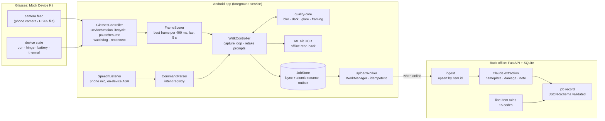

# FieldCapture

**Hands-free field capture on AI glasses.** A technician walks a water-damaged home wearing Meta glasses and never touches the phone. They say *"capture nameplate"*, *"capture damage, kitchen, north wall"* or *"note: subfloor soft by the cabinet"*. When they walk out, the back office has a job record with usable evidence, extracted fields with confidence scores, and draft estimate line items.

Built on **Meta Wearables Device Access Toolkit (DAT) 1.1.0** for Android. It runs on **Mock Device Kit**, which uses the phone's camera as the glasses camera, so no glasses are needed.

> **Status (2026-11-25):** the app, back office, quality gate, offline queue, tests and eval tooling are built.
> On-device verification, the labelled test set and the measured numbers are in progress.
> Every number in this README will link to [eval/REPORT.md](eval/REPORT.md). Progress log: [docs/JOURNAL.md](docs/JOURNAL.md).

## Architecture



## Setup (under 10 minutes)

**You need:** an Android 12+ phone with USB debugging on, `adb` (Android platform-tools), and [uv](https://docs.astral.sh/uv/). You don't need Android Studio or glasses.

1. **Back office**
   ```bash
   cd backend
   uv sync
   cp .env.example .env        # put ANTHROPIC_API_KEY=... in .env (extraction); everything else works without it
   uv run fieldcapture-server  # http://127.0.0.1:8000
   ```
2. **App.** Download `fieldcapture-debug-apk` from the latest [CI run](../../actions) and install it:
   ```bash
   adb install -r app-debug.apk
   adb reverse tcp:8000 tcp:8000   # the phone reaches the back office over USB
   ```
3. **Walk.** Open FieldCapture and allow the permissions. The mock glasses set themselves up and stream from the back camera. Tap **Start job**, then use your voice:
   - `capture nameplate`
   - `capture damage <room> <surface>`
   - `note: <anything>`
   - `pause job` / `resume job` / `end job`
   - `capture anyway`, `retake`, `undo last`, `status`

   Watch the record build at http://127.0.0.1:8000.

**Without a phone**
- Run the tests: `cd backend && uv run pytest -q`, and `cd android && ./gradlew :quality-core:test :app:testDebugUnitTest`.
- UI flows on the phone with [Maestro](https://github.com/mobile-dev-inc/maestro) (Apache-2.0): `powershell -File tools\maestro_run.ps1` runs the five flows in [`android/maestro/`](android/maestro/README.md) (settings, job buttons, double taps, glasses events mid-walk, leaving the app mid-walk). 5/5 pass.
- Bad signal with [Toxiproxy](https://github.com/Shopify/toxiproxy) (MIT) between the phone and a throwaway back office: `powershell -File tools\toxiproxy_run.ps1 [-Suite faults|outages]` (latency, an 8 KB/s uplink, reset connections, lost replies, outages). Results in [`eval/chaos/`](eval/chaos/).
- Fuzz the back office API with [Schemathesis](https://github.com/schemathesis/schemathesis) (MIT), against a throwaway server with extraction off: start one with `FIELDCAPTURE_PORT=8003 FIELDCAPTURE_EXTRACT=0 FIELDCAPTURE_DATA_DIR=<empty dir> uv run fieldcapture-server`, then `uv run --with schemathesis schemathesis run http://127.0.0.1:8003/openapi.json --checks all --exclude-checks positive_data_acceptance`. The excluded check flags our `item` form field, a JSON string, being rejected when it isn't JSON. On 2026-11-26 it found one crash (fixed, with a regression test); 1,759 generated requests then passed.
- Replay the whole eval from committed model responses, with no key and no spend:
  ```bash
  uv run --project backend python eval/run_extraction.py --cached
  uv run --project backend python eval/report.py
  ```

**Build from source:** open `android/` in Android Studio (Narwhal+, JDK 17, SDK 36). DAT comes from Maven Central and needs no token. Instrumented Mock Device Kit tests: `./gradlew :app:connectedDebugAndroidTest`.

## How a capture works

1. **Voice.** The phone's on-device recognizer listens continuously and the parser maps phrases to intents. One-shot commands fire on partial results, saving about 0.5–1 s.
2. **Reach back.** The tech looked at the thing *before* finishing the sentence. Every stream frame is scored on arrival, and the best frame from each 400 ms of the last 5 s is kept. The capture picks the best passing frame from speech-start onward.
3. **Quality gate (on device).** Blur, darkness and glare are checked on the region that matters; for nameplates that's the text found by on-device OCR. Framing is checked too: is the label cut off, or too small to read?
4. **No fuss.** If nothing passes, the tech gets **one** specific prompt ("Too dark. Turn on your light.", "Hold still.", "Label is cut off. Step back a little.") and the app keeps watching. The first good frame is taken without repeating the command. After two prompts it keeps the least-bad frame and flags it for the back office. *"Capture anyway"* accepts immediately.
5. **Durable before "Got it".** The evidence JPEG, its metadata and an outbox marker are each written, fsync'd and atomically renamed before the confirmation tone.
6. **Upload when there's signal.** WorkManager drains the outbox under a network constraint. Each item's id is its idempotency key, so replays after a dropped connection are acknowledged rather than duplicated.
7. **Proven with counts, not claimed.** [`tools/chaos_run.ps1`](tools/chaos_run.ps1) breaks a real walk on the phone. It makes the back office unreachable for 60 s, kills the app with uploads queued, and powers the glasses off mid-walk. Then it compares what the phone acknowledged with what the server stored. In the 2026-11-25 run ([`eval/chaos/chaos-20261125-195606.json`](eval/chaos/chaos-20261125-195606.json)):
   - The phone acknowledged **5 captures and 3 notes, and the server holds exactly those**, with none missing, none extra and none uploaded twice.
   - The killed walk resumed under the same job id.
   - Queued items landed about 10 s after the route came back.
   - The capture attempted with the glasses off was refused out loud, and the note was still saved.
   - "Glasses back" was spoken 0.26 s after power-on.
   - The first run ([`chaos-20261125-195142.json`](eval/chaos/chaos-20261125-195142.json)) caught a bug: "Glasses back" was never spoken after a reconnect. It's fixed.
7. **Back office.** Claude extracts structured fields. Confidence is calibrated from independent signals: model self-report, agreement with the on-device OCR, format checks and quality. Deterministic rules turn observations into draft line items, each citing its evidence.

## Decisions (and what we cut)

| Decision | Why |
|---|---|
| **Android + DAT 1.1.0** | The dev machine is Windows (iOS DAT needs Xcode). 1.1 adds `DeviceSession.pause()/resume()`. |
| **Phone mic for voice** | Mock Device Kit has no glasses audio path: its feed is video-only and mock audio emits no PCM. DAT Speech and Audio are experimental and can't be published. On real glasses the HFP/SCO mic competes with the camera over Bluetooth (issues #159, #206, #196). On-device recognition also works with no signal. |
| **Deterministic command grammar, not an LLM** | Works offline, adds about 0 ms, and is unit-tested. A 4th command is one registry entry. |
| **Thresholds measured with the shipped code** | The phone records its own metrics in dataset mode; `eval/qc_thresholds.py` fits on tune scenes and tests on held-out scenes. |
| **Rules, not prompts, for line items** | An estimator must be able to read and argue with them. Unknown quantities stay `null` + `needs_measurement`. |
| **Claude via a back office** | The API key never ships in the APK, and the eval runs the same extractor code. |
| **A phone screen that stays out of the way** | The tech talks to the glasses, so the screen is a glance. It shows the status in plain words ("Recording", "Glasses off", "Reconnecting…"), a live view of what the glasses see (~4 fps from the frame buffer), and one button per action: only Pause *or* Resume, never both. End job is not highlighted, because it can't be undone. Glasses internals, debug settings and the Mock Device Kit controls sit under "Show developer tools". |

**Cut, on purpose**
- Wake word: listening is continuous, but only grammar matches act.
- Display-glasses UI: the mock doesn't support it, and techs need audio.
- On-device VLM.
- Auth and multi-tenant back office.
- Xactimate export: we define our own 15 codes, as the brief asks.
- AR measurement: it needs the phone in hand.

## Models and cost

- **Nameplate and damage photos:** Claude Opus 5.5.
- **Notes:** Claude Haiku 5.5.
- **Measured:** accuracy and cost per job for Haiku, Sonnet and Opus 5.5, plus a Haiku→Opus cascade, in [eval/REPORT.md](eval/REPORT.md) §3 and §8.

## Known limitations

These are the ones we know about; the full list is in [docs/MEMO.md](docs/MEMO.md).

**What the mock can't tell us:**
- Real Bluetooth bandwidth and adaptive bitrate.
- The ~53° FOV crop.
- Real photo-transfer latency.
- Glasses heat and battery under sustained streaming.
- HFP mic contention.

**Not done yet:**
- Raw (YUV) DAT streams pause when the app is backgrounded on real glasses, per Meta's sample. On Mock Device Kit they don't: a walk kept streaming and capturing for 2 minutes with the screen off (RESEARCH §5a). That can't be checked without glasses, so the app keeps the screen on during a walk. Pocket mode (a compressed stream plus our own software HEVC decode) is the next step.
- Damage framing on device checks only exposure and blur. "Damage cut off" is flagged later by the back office.
- Manufacture date is taken as printed. It isn't yet decoded from brand-specific serial formats.
- A walk killed by the OS resumes on relaunch only if it saw activity in the last 30 minutes; older open jobs are closed and finalized instead. After a resume, "undo" only reaches captures made since the restart.
- Offline uploads were tested with the back office unreachable (phone online, no route), not with the phone fully offline: on our test setup the PC's internet runs through the phone, so airplane mode was off-limits.

**Debug builds only (by design, absent from release):** launching the app with `mwdat_ui_testing=true` starts Meta's loopback MockDevice test server, and `DebugCommandReceiver` accepts walk commands from adb (protected by `android.permission.DUMP`). On a debug build, another app on the same phone could start the test server and drive the *simulated* glasses.

## With two more weeks

1. Pocket mode: compressed HEVC with a software decode (MediaTek's hardware decoder corrupts DAT streams, per Meta's sample).
2. Five techs on real glasses in week one. Instrument drop rate, retake rate, time per capture and false-retake complaints.
3. DAT Speech as the voice path once Meta allows publishing it. Only text crosses Bluetooth, so the mic no longer competes with the camera.
4. Size from a single-point range sensor, or a placed reference card, instead of ambient reference objects.
5. Serial-number date decoders for the top water-heater and HVAC brands; cross-check against the printed date.
6. Back-office review UI for correcting fields, with corrections fed back into calibration.

## AI tools used

Meta ships DAT skills and a docs MCP for several AI coding tools (its `dat-docs-mcp` skill covers Claude Code, Codex, Cursor and others), plus `AGENTS.md` and `llms.txt` for tools without plugins. We used the **Claude Code** plugin, installed at project scope in [`.claude/settings.json`](.claude/settings.json), so it loads for anyone who opens this repo in Claude Code.

| Tool | What it was used for | Where it shows |
|---|---|---|
| **Claude Code** (Claude Fable 5.2 / Opus 5.5) | SDK research, prior-art scan, planning, most of the code, tests and docs | Every commit (`Co-Authored-By` trailer). Each decision and its reason is in the [journal](docs/JOURNAL.md). |
| **Meta `mwdat-android` plugin 1.1.0: DAT skills** | **Session 1**, before the plugin was installed: the skills and `AGENTS.md` were read straight from the SDK repo. They shaped the session supervisor (camera attached once at STARTED, PAUSED keeps it, STOPPED is terminal) and the phone-mic decision (`audio-streaming`: the mock camera carries no audio). The named-device selector and capability-revival rules came from Meta's BirdSpotter sample, not the skills. **2026-11-25:** loaded `dat-conventions`, `session-lifecycle`, `camera-streaming` and `mockdevice-testing` in Claude Code and audited our DAT code against them. That found 5 gaps, all fixed: collectors weren't guaranteed to subscribe before `start()`; a failed `addCamera`/`stream.start()` left the walk stuck; no permission check before streaming on resume or reconnect; a late "resume job" was lost before the pause settled; a stopped stream under a started camera was never restarted. | [`GlassesController.kt`](android/app/src/main/java/app/fieldcapture/glasses/GlassesController.kt) (header lists the rules it follows); [RESEARCH.md §1–2](docs/RESEARCH.md); journal, 2026-11-25 session 2 |
| **Meta DAT docs MCP** (`search_dat_docs`) | Checked each of our measured mock behaviours against docs v1.1, so the memo only claims what is new (e.g. the I420 frame layout is undocumented). Found the documented "restart the stream of a started camera" rule. Confirmed the `checkPermissionStatus` contract. | [RESEARCH.md §5b](docs/RESEARCH.md) |
| **Meta MockDevice MCP** | The app calls `startTestServer` in debug builds so the MCP can drive the simulated glasses. On this Windows machine `mock_connect` fails (it needs `adb` on PATH), so [`tools/chaos_run.ps1`](tools/chaos_run.ps1) drives the same test-server HTTP routes directly: power off/on, unfold, don. | [`MainActivity.kt`](android/app/src/main/java/app/fieldcapture/MainActivity.kt), [`MockGlassesController.kt`](android/app/src/main/java/app/fieldcapture/mock/MockGlassesController.kt), `tools/chaos_run.ps1` |
| **Google's Android skills** ([android/skills](https://github.com/android/skills), Apache-2.0, local in `.claude/skills`) | `android-intent-security`: audited the exported components (`MainActivity`, the debug `DebugCommandReceiver`), `WalkService` and the notification `PendingIntent`. No code changes; one debug-only risk documented under Known limitations. `android-cli`, `testing-setup`, `anr-audit-and-fix` and `android-permissions-security` are installed but not used yet. | Journal, 2026-11-25 session 2 |
| `javap` | Every DAT API signature checked against the 1.1.0 AARs, never assumed | [RESEARCH.md §4.4](docs/RESEARCH.md) |
| **Claude models** (Haiku/Sonnet/Opus 5.5) | Run *inside the product*, for extraction in the back office | [`backend/`](backend/), model choice in [`eval/REPORT.md`](eval/REPORT.md) |

The author reviewed every change.

## Repo map

| Path | What |
|---|---|
| `android/app` | DAT integration, voice, capture loop, store, sync, UI, Mock Device Kit controls |
| `android/quality-core` | Pure-Kotlin quality metrics and gate (shared with the eval) |
| `backend/` | FastAPI back office, Claude extractors, line-item rules, job record assembly |
| `schemas/` | `job_record.schema.json`, `line_item_codes.json` |
| `eval/` | Labelling tool, threshold fitting, extraction eval, report |
| `docs/` | Plan, journal, research notes, memo |
