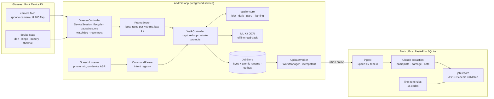

# FieldCapture

**Hands-free field capture on AI glasses.** A technician walks a water-damaged home wearing Meta glasses and never touches the phone. They say *"capture nameplate"*, *"capture damage, kitchen, north wall"* or *"note: subfloor soft by the cabinet"*. When they walk out, the back office has a job record with usable evidence, extracted fields with confidence scores, and draft estimate line items.

Built on **Meta Wearables Device Access Toolkit (DAT) 1.1.0** for Android. It runs on **Mock Device Kit**, which uses the phone's camera as the glasses camera, so no glasses are needed.

> **Status (2026-11-25):** the app, back office, quality gate, offline queue, tests and eval tooling are built.
> On-device verification, the labelled test set and the measured numbers are in progress.
> Every number in this README will link to [eval/REPORT.md](eval/REPORT.md). Progress log: [docs/JOURNAL.md](docs/JOURNAL.md).

## Architecture



## Setup (under 10 minutes)

**You need:** an Android 12+ phone with USB debugging on, `adb` (Android platform-tools), and [uv](https://docs.astral.sh/uv/). You don't need Android Studio or glasses.

1. **Back office**
   ```bash
   cd backend
   uv sync
   cp .env.example .env        # put ANTHROPIC_API_KEY=... in .env (extraction); everything else works without it
   uv run fieldcapture-server  # http://127.0.0.1:8000
   ```
2. **App.** Download `fieldcapture-debug-apk` from the latest [CI run](../../actions) and install it:
   ```bash
   adb install -r app-debug.apk
   adb reverse tcp:8000 tcp:8000   # the phone reaches the back office over USB
   ```
3. **Walk.** Open FieldCapture and allow the permissions. The mock glasses set themselves up and stream from the back camera. Tap **Start job**, then use your voice:
   - `capture nameplate`
   - `capture damage <room> <surface>`
   - `note: <anything>`
   - `pause job` / `resume job` / `end job`
   - `capture anyway`, `retake`, `undo last`, `status`

   Watch the record build at http://127.0.0.1:8000.

**Without a phone**
- Run the tests: `cd backend && uv run pytest -q`, and `cd android && ./gradlew :quality-core:test :app:testDebugUnitTest`.
- Replay the whole eval from committed model responses, with no key and no spend:
  ```bash
  uv run --project backend python eval/run_extraction.py --cached
  uv run --project backend python eval/report.py
  ```

**Build from source:** open `android/` in Android Studio (Narwhal+, JDK 17, SDK 36). DAT comes from Maven Central and needs no token. Instrumented Mock Device Kit tests: `./gradlew :app:connectedDebugAndroidTest`.

## How a capture works

1. **Voice.** The phone's on-device recognizer listens continuously and the parser maps phrases to intents. One-shot commands fire on partial results, saving about 0.5–1 s.
2. **Reach back.** The tech looked at the thing *before* finishing the sentence. Every stream frame is scored on arrival, and the best frame from each 400 ms of the last 5 s is kept. The capture picks the best passing frame from speech-start onward.
3. **Quality gate (on device).** Blur, darkness and glare are checked on the region that matters; for nameplates that's the text found by on-device OCR. Framing is checked too: is the label cut off, or too small to read?
4. **No fuss.** If nothing passes, the tech gets **one** specific prompt ("Too dark. Turn on your light.", "Hold still.", "Label is cut off. Step back a little.") and the app keeps watching. The first good frame is taken without repeating the command. After two prompts it keeps the least-bad frame and flags it for the back office. *"Capture anyway"* accepts immediately.
5. **Durable before "Got it".** The evidence JPEG, its metadata and an outbox marker are each written, fsync'd and atomically renamed before the confirmation tone.
6. **Upload when there's signal.** WorkManager drains the outbox under a network constraint. Each item's id is its idempotency key, so replays after a dropped connection are acknowledged rather than duplicated.
7. **Back office.** Claude extracts structured fields. Confidence is calibrated from independent signals: model self-report, agreement with the on-device OCR, format checks and quality. Deterministic rules turn observations into draft line items, each citing its evidence.

## Decisions (and what we cut)

| Decision | Why |
|---|---|
| **Android + DAT 1.1.0** | The dev machine is Windows (iOS DAT needs Xcode). 1.1 adds `DeviceSession.pause()/resume()`. |
| **Phone mic for voice** | Mock Device Kit has no glasses audio path: its feed is video-only and mock audio emits no PCM. DAT Speech and Audio are experimental and can't be published. On real glasses the HFP/SCO mic competes with the camera over Bluetooth (issues #159, #206, #196). On-device recognition also works with no signal. |
| **Deterministic command grammar, not an LLM** | Works offline, adds about 0 ms, and is unit-tested. A 4th command is one registry entry. |
| **Thresholds measured with the shipped code** | The phone records its own metrics in dataset mode; `eval/qc_thresholds.py` fits on tune scenes and tests on held-out scenes. |
| **Rules, not prompts, for line items** | An estimator must be able to read and argue with them. Unknown quantities stay `null` + `needs_measurement`. |
| **Claude via a back office** | The API key never ships in the APK, and the eval runs the same extractor code. |

**Cut, on purpose**
- Wake word: listening is continuous, but only grammar matches act.
- Display-glasses UI: the mock doesn't support it, and techs need audio.
- On-device VLM.
- Auth and multi-tenant back office.
- Xactimate export: we define our own 15 codes, as the brief asks.
- AR measurement: it needs the phone in hand.

## Models and cost

- **Nameplate and damage photos:** Claude Opus 5.5.
- **Notes:** Claude Haiku 5.5.
- **Measured:** accuracy and cost per job for Haiku, Sonnet and Opus 5.5, plus a Haiku→Opus cascade, in [eval/REPORT.md](eval/REPORT.md) §3 and §8.

## Known limitations

These are the ones we know about; the full list is in [docs/MEMO.md](docs/MEMO.md).

**What the mock can't tell us:**
- Real Bluetooth bandwidth and adaptive bitrate.
- The ~53° FOV crop.
- Real photo-transfer latency.
- Glasses heat and battery under sustained streaming.
- HFP mic contention.

**Not done yet:**
- Raw (YUV) DAT streams pause when the app is backgrounded, per Meta's sample. Pocket mode, with the screen off and a compressed stream plus our own software HEVC decode, is the next step. Until then, keep the screen on during a walk.
- Damage framing on device checks only exposure and blur. "Damage cut off" is flagged later by the back office.
- Manufacture date is taken as printed. It isn't yet decoded from brand-specific serial formats.

## With two more weeks

1. Pocket mode: compressed HEVC with a software decode (MediaTek's hardware decoder corrupts DAT streams, per Meta's sample).
2. Five techs on real glasses in week one. Instrument drop rate, retake rate, time per capture and false-retake complaints.
3. DAT Speech as the voice path once Meta allows publishing it. Only text crosses Bluetooth, so the mic no longer competes with the camera.
4. Size from a single-point range sensor, or a placed reference card, instead of ambient reference objects.
5. Serial-number date decoders for the top water-heater and HVAC brands; cross-check against the printed date.
6. Back-office review UI for correcting fields, with corrections fed back into calibration.

## AI tools used

- **Claude Code** (Anthropic Claude Fable 5.2 / Opus 5.5) was used for:
  - SDK research (docs, CHANGELOG, Meta's samples and skills, the issue tracker)
  - the prior-art scan
  - architecture and planning
  - most of the code, the tests and the docs
- It read Meta's `mwdat-android` Claude Code skills and `AGENTS.md` straight from the SDK repo.
- SDK signatures were verified with `javap` against the 1.1.0 AARs, never assumed.
- The author reviewed every change. The [journal](docs/JOURNAL.md) records each decision and why.
- **Claude models** (Haiku/Sonnet/Opus 5.5) run inside the product, for extraction.

## Repo map

| Path | What |
|---|---|
| `android/app` | DAT integration, voice, capture loop, store, sync, UI, Mock Device Kit controls |
| `android/quality-core` | Pure-Kotlin quality metrics and gate (shared with the eval) |
| `backend/` | FastAPI back office, Claude extractors, line-item rules, job record assembly |
| `schemas/` | `job_record.schema.json`, `line_item_codes.json` |
| `eval/` | Labelling tool, threshold fitting, extraction eval, report |
| `docs/` | Plan, journal, research notes, memo |
