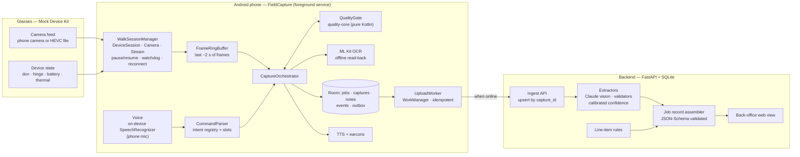

# FieldCapture — Plan

> Living document. Tick boxes as work lands; log the details in [JOURNAL.md](JOURNAL.md).
> SDK facts and sources: [RESEARCH.md](RESEARCH.md). Last updated: 2026-11-25 (M0).

## 0. How we win

Rubric (100): works end-to-end **20** · extraction & evaluation **20** · SDK depth **15** · research & hardware judgment **15** · capture quality **10** · product judgment **10** · code & README **10**.

1. **Honest numbers beat features.** Every number in a doc comes from a committed script run over committed frames. Raw model responses are cached in the repo, so reviewers can reproduce the eval without an API key.
2. **Every core requirement works end to end before any stretch work starts.**
3. **Measurement and production share code.** Quality thresholds are computed by the same Kotlin module that runs on the phone, and the eval calls the same backend extractor the app uses.
4. **Flag limitations ourselves.** A flagged limitation costs nothing; one the reviewers find costs a lot.
5. **Small commits, often, with a journal entry per step.** The reviewers read the history.
6. **Avoid the disqualifiers.** Demo footage must come from a tagged commit (`demo-v1`). The test set is committed with the numbers. All code stays small enough to explain in the live session.

### Where existing projects fall short (details in RESEARCH.md §4)

Two public repos target this exact brief. Both were created 2026-11-24:

- **`vaibhavgupta856/FieldCapture`** is an Android DAT 1.1 scaffold. Its quality thresholds are seed values, and it has no eval, no backend, no demo and no sample records. It needs four button taps before a walk can start.
- **`AgrimaBhatnagar/FieldCapture`** is a Python web prototype with an iOS scaffold that has never been compiled, so it has no real DAT integration.

We beat both with five things:

- **A real loop on Mock Device Kit.** It is zero-touch from the moment the tech dons the glasses.
- **Measured thresholds and an eval set.** The eval includes calibrated confidence.
- **A real back office.** Ingest is idempotent.
- **Lifecycle edge cases proven by instrumented tests.** Mock Device Kit drives them.
- **A memo built on our own measurements.**

---

## 1. Requirements → design → proof

| # | Brief requirement | Our design (section) | Proof reviewers can check |
|---|---|---|---|
| C1 | Registration, permissions, start/pause/resume/stop, recovery when the device drops mid-walk | `WalkSessionManager` over DAT 1.1 `DeviceSession` (§5). Uses `pause()`/`resume()`, a reconnect supervisor and a STARTING watchdog. | MDK instrumented test matrix (§5.3) in CI logs. The demo shows a power-off mid-walk. |
| C2 | Voice commands `capture nameplate`, `capture damage [room] [surface]`, `note: [text]`. Phone-mic fallback, with the reason stated. | On-device `SpeechRecognizer` feeds an intent-registry parser (§4). DAT Speech is not built (cut list; reason in README). | Parser unit tests, scripted-utterance accuracy, demo |
| C3 | On-device check for blurry, dark and badly framed frames, a retake prompt, and the thresholds with how we chose them | `quality-core` (pure Kotlin) handles best-frame selection, auto-retake and specific prompts (§6) | ROC and threshold report on held-out scenes. The thresholds JSON is versioned. |
| C4 | Extraction: nameplate (make/model/serial/date), damage (room/surface/type/size), note → structured fields, all with confidence | Backend extractors use Claude vision with validators, an OCR cross-check and calibrated confidence (§7) | Per-field accuracy, AUROC/ECE, risk-coverage (§10) |
| C5 | One JSON job record against our own schema, plus 10–15 self-defined line-item codes | JSON Schema 2020-12 and a rules engine with 15 codes (§8) | Schema validation tests and 3 real sample records |
| C6 | Test set ≥ 40 frames (≥ 10 nameplates, ≥ 10 low-light), per-field accuracy, five worst failures with causes | Target ~120 frames, scene-level tune/test split (§10) | `eval/REPORT.md` regenerated by `eval/run_all.py` |
| C7 | Queue offline, upload when signal returns, nothing lost | Write-ahead Room outbox, WorkManager, idempotent server (§9) | Chaos-run counts (captured = received, 0 duplicates). Airplane-mode segment in the demo. |
| S1 | Stretch: size without depth vs tape measure | Reference-object scaling compared with direct VLM estimate (§11.1) | MAPE / median APE / % within ±25% |
| S2 | Stretch: cost per job and capture→record latency, then cut one in half | Instrumentation plus a measured 2× cut (§11.2) | Before/after table with accuracy held constant |

Deliverables are in §15.

---

## 2. Architecture



**Planned repo layout**

```
android/            Gradle project — open this folder in Android Studio
  app/              DAT integration, voice, orchestration, Room, sync, UI, MDK debug panel
  quality-core/     pure-Kotlin JVM module: QC metrics + decisions (+ CLI used by the eval)
backend/            FastAPI ingest, extractors, line-item rules, job assembler, back-office page
schemas/            job_record.schema.json, capture_upload.schema.json, line_item_codes.json
eval/               dataset (frames + labels), scripts, cached model responses, REPORT.md
samples/            3 real job records (+ evidence thumbnails)
tools/              ffmpeg transcode, labeling page, chaos scripts
docs/               PLAN, JOURNAL, RESEARCH, MEMO (research memo), ARCHITECTURE
```

---

## 3. Key decisions

| Decision | Why | Rejected alternatives |
|---|---|---|
| **Android, Kotlin, Compose, DAT 1.1.0** (Maven Central, no token) | The dev machine is Windows, and iOS DAT needs Xcode on a Mac. 1.1.0 (2026-11-20) is the 1.x line the brief calls "DAT 1.0", and it adds `DeviceSession.pause()/resume()`. | iOS (no Mac); 1.0.x (no session pause API) |
| **Mock Device Kit fed by the phone camera** (`setCameraFeed(CameraFacing.BACK)`), with HEVC files for repeatable runs | Live walk-throughs for the demo. Replayable files for regression runs and the failure drill. | Video-only: too static for a demo |
| **Voice = phone mic → Android on-device `SpeechRecognizer`**. DAT Speech is behind a flag and exercised in tests. | Mock Device Kit has no glasses audio: its camera feed is video-only and mock audio streaming emits no deterministic PCM. DAT Speech and Audio are experimental and can't be published. On real glasses the HFP/SCO mic competes with the camera over Bluetooth (issues #159, #206, #196). On-device ASR also works in an attic with no signal. | Cloud ASR (fails offline); Vosk (weaker free-text accuracy; fallback if the phone lacks on-device ASR) |
| **Deterministic grammar parser** (intent registry with slots and fuzzy vocab) | Works offline, adds about 0 ms, is unit-testable, and the live-session 4th command becomes one registry entry | LLM intent parsing (latency, cost, needs network) |
| **Best-frame selection plus auto-retake from the live stream** | Head motion is the main cause of blur. Picking the sharpest frame around the utterance and silently waiting for a good one avoids most prompts. | One frame per command |
| **`quality-core` as a pure-Kotlin module**, shared by the app and a JVM CLI | Thresholds are measured with exactly the code that ships | A Python re-implementation (drift risk) |
| **Backend: Python 3.12, FastAPI, SQLite, run with `uv`** | Keeps the API key off the phone. The eval imports the same extractors. The back office gets a real page. `uv` makes setup fast. | Phone calling the LLM directly (key in the APK, eval drift) |
| **Claude via the official `anthropic` SDK with structured outputs.** The eval picks the model per task among Haiku 5.5, Sonnet 5.5 and Opus 5.5 (Opus 5.5 is the default until measured). | Strong at reading nameplates and following JSON schemas. The user approved benchmarking all three. Rough cost is $0.01–$0.50 per job, to be measured. | Fixed model with no measurement |
| **Deterministic line-item rules**, with the LLM only extracting observations | Auditable, testable, and explainable to an estimator | LLM writes line items (unverifiable) |
| **Stretch goals: size without depth + cost & latency** | Size drives line-item quantities, and cost/latency comes almost for free from our instrumentation | Glasses vs phone (weak without glasses); sensor prototype (no parts) |
| **Prebuilt debug APK in GitHub Releases**, plus CI | Reviewer setup under 10 min without installing Android Studio | Build-from-source only |

### What we cut, and why (goes into the README)

- **Wake word.** Listening is continuous while a walk is active, but only grammar matches (`capture…`, `note…`, `pause job`…) do anything.
- **Display glasses UI.** Mock Device Kit doesn't support display glasses, and techs need audio, not a HUD.
- **On-device VLM.** Too big and too slow for a phone. On-device OCR plus a read-back covers the offline case.
- **Auth and multi-tenant back office.**
- **Xactimate/ESX export.** We define our own codes, as the brief asks.
- **AR measurement.** It needs the phone in hand, which defeats the glasses.
- **Real-time video to the back office.** Not needed for the job record, and expensive on Bluetooth.

---

## 4. Voice commands

| Intent | Example utterances | Slots | Notes |
|---|---|---|---|
| `CAPTURE_NAMEPLATE` | "capture nameplate", "capture name plate", "capture the label", "capture data plate" | — | |
| `CAPTURE_DAMAGE` | "capture damage, kitchen, north wall", "capture damage ceiling" | room?, surface? | Fuzzy-matched against room and surface vocabularies. A missing room inherits the current room. Unknown words are kept raw for the back office, and the tech is never blocked. |
| `NOTE` | "note: subfloor soft by the cabinet", "note that…", "add note…" | free text | Offline rule-based fields on device; refined by Claude on the backend |
| Lifecycle (product judgment) | "pause job", "resume job", "end job" | — | Mapped to DAT `pause()`/`resume()`/stop |
| Recovery (product judgment) | "capture anyway", "retake", "undo last", "status" | — | Escape hatch from QC; replace or remove the last capture; read back counts and the upload queue |

- **ASR.** Continuous on-device recognition. The parser takes the n-best list and picks the first hypothesis that parses.
- **Feedback.** Spoken lines stay under 1.5 s: "Got it — nameplate", "Hold still…", "Too dark — turn on your light". Earcons mark success and failure. Prompts are rate-limited.
- **Live-session readiness.** Adding "capture moisture reading [value] [location]" should take one registry entry plus a number normalizer, one schema field, one line-item rule and one test. We rehearse this before submitting.

---

## 5. Session lifecycle (DAT) and recovery

### 5.1 Walk state machine (app level)

`IDLE → CONNECTING → ACTIVE ⇄ PAUSED (user) / SUSPENDED (device: doff, hinge, thermal, battery, cap-touch) → RECONNECTING (device lost) → ACTIVE … → ENDED`

The job stays open across every state except `ENDED`. Every transition is persisted as a timeline event in the job record.

### 5.2 Rules (from docs, samples and the issue tracker; see RESEARCH.md)

- **Registration and permissions.** `Wearables.initialize` runs once. Before creating a session, wait for `registrationState == REGISTERED`; 1.1 returns `NOT_REGISTERED` otherwise. The DAT camera permission goes through `RequestPermissionContract`. Android permissions: `BLUETOOTH_CONNECT`, `CAMERA` (only for the phone-camera mock feed), `RECORD_AUDIO` and `POST_NOTIFICATIONS`.
- **Device selection.** Use `SpecificDeviceSelector(rankedDevice)`. `AutoDeviceSelector` built at tap time races and fails with `NO_ELIGIBLE_DEVICE`.
- **Session start.** Collect `state` and `errors` *before* `start()`. Attach the Camera once at `STARTED`; it survives `PAUSED → STARTED`. Treat `STOPPED` as terminal and create a new session.
- **STARTING watchdog.** If the session is still `STARTING` after 15 s, stop it and recreate (issue #237).
- **Device drop.** Signals: session `STOPPED` or errors, camera `STOPPED` after it had started, `linkState == DISCONNECTED`, or stream errors. Response: the walk moves to `RECONNECTING` and a spoken line explains it. The supervisor watches `Wearables.devices`/`devicesMetadata` and recreates the session with backoff (1, 2, 4 … 15 s). The job ID stays the same.
- **Commands while disconnected.** Captures are refused out loud ("Glasses offline — capture not taken") and logged. Notes still work, because they use the phone mic.
- **Device-side pauses (1.1).** Stream errors `HINGE_CLOSED`, `THERMAL_HOT`, `BATTERY_LOW` and `PEAK_POWER_LIMIT` each get their own spoken guidance. The stream resumes on its own; we never force it.
- **Device state.** Battery, charging, don and thermal state are observed. The app warns once when battery drops below 20% or thermal reaches MODERATE.
- **Photo capture.** One `capturePhoto()` in flight at a time, only while STREAMING, with a 15 s timeout. After a photo transfer, restart any Motion/Speech/Inputs capability that dropped.
- **Pocket mode.** A raw YUV stream pauses when the app is backgrounded, per Meta's BirdSpotter sample. The plan is a foreground service plus `compressVideo = true` with our own MediaCodec decode (in-band VPS/SPS/PPS, issue #155). Verify on MDK first; fall back to screen-on mode if time runs out.

### 5.3 MDK instrumented test matrix (androidTest)

| # | Scenario (MockDeviceKit lever) | Expected app behaviour |
|---|---|---|
| L1 | Happy path: `enable` → `pairGlasses` → `powerOn/unfold/don` → start walk → capture → end | Job record contains the capture; events: started, stopped |
| L2 | Start before registration: `MockDeviceKitConfig(initiallyRegistered=false)` and `setRegistrationResult(true/false)` | Registration flow runs; a failure is spoken and the app doesn't crash |
| L3 | Camera permission denied: `permissions.set/setRequestResult(CAMERA, Denied)` | Guidance prompt; walk stays in CONNECTING |
| L4 | User pause/resume via `DeviceSession.pause()/resume()` | Stream PAUSED → STREAMING; captures during the pause are refused politely |
| L5 | `doff()` mid-walk, then `don()` | SUSPENDED → ACTIVE automatically |
| L6 | `fold()` mid-walk (HINGE_CLOSED), then `unfold()` | SUSPENDED with a hinge prompt → ACTIVE |
| L7 | `powerOff()` mid-walk, then `powerOn()` | RECONNECTING → new session → same job, captures continue, gap logged |
| L8 | `setThermalLevel(...)` / `setBatteryLevel(5)` | Thermal or battery prompt; stream-pause handling |
| L9 | `setDATAppUpdateRequirementEnabled(true)` / firmware requirement | Update-required error surfaced, no crash loop |
| L10 | Concurrent captures | Serialized; `CaptureInProgress` never reaches the user |
| L11 | Process death mid-walk (kill and relaunch) | Open job restored from Room; queued captures still upload |
| L12 | Speech via `MockSpeechKit` (`INJECTED` + `simulateTranscription`) | "capture damage kitchen north wall" → capture with correct slots |

We also enable the MockDevice MCP test server in debug builds (`startTestServer` via the `mwdat_ui_testing` extra), so Claude Code can drive the simulated glasses during development and in the live session.

---

## 6. Capture quality gate (on device)

### 6.1 Metrics

All metrics are computed on luma, downscaled to a fixed working size so they are comparable across stream qualities.

- **Sharpness.** Variance of Laplacian and Tenengrad. For nameplates we measure on the **text region** from ML Kit, because background blur doesn't matter.
- **Exposure.** Mean luma, p5/p95, % crushed blacks (< 16) and % clipped (> 250). Clipping catches glare on metal plates.
- **Motion.** Inter-frame difference in the ring buffer, used to prefer still moments. The IMU is experimental and only an option on real glasses.
- **Framing (nameplate).** Text present, text box not touching the frame edges (≥ 2% margin), median text-line height ≥ T px (otherwise too far), skew ≤ T°.
- **Framing (damage).** Honest scope: on-device we can check exposure, blur and "not a featureless close-up". The backend VLM later flags "damage not fully in frame". Documented as a limitation.

### 6.2 Decision and UX (prompts a tech wouldn't switch off)

1. On a command, score every frame from about 1.5 s before the utterance ended to about 2 s after it. Take the best one that passes all checks. Most captures never prompt.
2. If none passes, give **one specific, actionable prompt**: "Too dark — turn on your light", "Hold still", "Nameplate cut off — step back", "Too far — move closer", "Glare — tilt your head". Keep scanning; the first passing frame is accepted with "Got it". The tech doesn't need to repeat the command.
3. After 2 prompts (or about 6 s), accept the best frame, flag it `low_quality` in the record and move on. The tech is never trapped in a loop. "Capture anyway" accepts immediately.
4. Session-level nudges replace repeated prompts: "Low light in this room — headlamp on?" is said once per room.
5. For a nameplate, also gate the high-res `capturePhoto()` still when it arrives, because the head may have moved. Keep the better of still and stream frame as evidence.

### 6.3 How the thresholds are chosen (the brief asks for this)

1. Capture labeled frames with the app's **dataset mode**. It saves the frames the gate actually sees, their metrics, and a condition tag chosen before the shot.
2. Label with a small local page: *usable for its purpose?* (nameplate: can a human read the serial? damage: is it visible with context?) plus the reasons.
3. Run `quality-core` CLI → metrics CSV. This is the same code as the app.
4. `eval/qc_thresholds.py` computes ROC per metric on the **tune** scenes and picks an operating point with **≤ 5% false retakes on good frames** while maximizing recall of bad frames. Rationale: a false retake costs about 5 s and patience; a missed bad nameplate costs a return visit. It then reports on the held-out **test** scenes.
5. We also show **downstream impact**: extraction accuracy above and below each threshold. Thresholds are justified by results, not taste.
6. Output: `quality-core/src/main/resources/thresholds.json` (versioned), plus the ROC charts and examples of misses and false retakes in the eval report.

---

## 7. Extraction and confidence (backend)

**Inputs per capture.** The best QC'd frame, plus the `capturePhoto()` still when available. Also the device OCR JSON (ML Kit lines, boxes and confidences), the transcript and parsed slots, and the QC metrics.

### 7.1 Nameplate

1. Crop to the OCR text region plus a margin. This means fewer image tokens and more focus.
2. Claude vision returns structured output. Each field (`make`, `model`, `serial`, `manufacture_date`, with optional capacity, fuel and voltage) comes back as `{value, verbatim_evidence, self_confidence, unreadable_reason}`. The rule: **never infer a value that isn't printed — return null.**
3. Validators: brand alias table, serial and model format plausibility, date normalized to `YYYY-MM`. For brands whose rules we can verify, a date is also decoded from the serial (`date_source: printed | decoded_from_serial`).
4. OCR agreement: fuzzy match between the VLM value and the ML Kit tokens. This is a strong signal for serials.
5. **Calibrated confidence.** A logistic model on [self_conf, OCR match, format validity, date cross-check, sharpness, brightness, text height] estimates P(correct). It is fitted on tune scenes only. Optional self-consistency on a second frame is used only if the eval shows it pays for itself.

### 7.2 Damage

- **Room and surface.** Come from the voice slots, with confidence = ASR confidence × parse match. The VLM cross-checks them and flags a mismatch, for example "surface=ceiling" when the image shows a floor.
- **VLM output.** `damage_type` (water_stain, active_leak, swelling_warping, peeling_bubbling, mold_mildew, crack, hole, rot, efflorescence, other, none_visible), `material`, `severity`, a damage bounding box, and reference objects with boxes and types.
- **Size.** See §11.1.

### 7.3 Note

- **Transcript to fields.** Claude (text) produces `{category, component, condition, location_text, room (from context), severity, measurement?, follow_up_needed, line_item_hints[]}` with per-field confidence.
- **Offline fallback.** A rule-based keyword extractor on the device, so the record is never empty offline.

---

## 8. Job record and line items

**Schema** (`schemas/job_record.schema.json`, JSON Schema 2020-12). Top-level sections:

- `schema_version`, `job_id`
- `site`, `technician`, `device` (glasses model, `mock: true`, SDK, app and phone versions)
- `session` (timeline events, disconnect count, duration)
- `rooms[]`
- `captures[]`: `type`, `command{transcript, asr_conf, slots}`, `evidence{uri, sha256, w, h, source}`, `quality{metrics, passed, retakes, override}`, and `fields{name:{value, confidence, source, evidence_text}}`
- `notes[]`
- `line_items[]`
- `review{flags, low_confidence_fields}`
- `processing{models, tokens, cost_usd, latency}`

Any field below its review threshold gets a review flag. Nothing is silently dropped.

**Line-item codes (our own, 15):**

| Code | Description | Unit |
|---|---|---|
| `WTR-EXT` | Water extraction, floor surface | SF |
| `WTR-DRY` | Structural drying equipment (air movers + dehumidifier), per day | DAY |
| `MST-MAP` | Moisture mapping and documentation, per room | EA |
| `ANT-APP` | Apply antimicrobial agent | SF |
| `DRY-RR` | Wall drywall remove & replace (hang, tape, finish) | SF |
| `DRY-FC2` | Flood cut wall drywall 2 ft above floor | LF |
| `CLG-RR` | Ceiling drywall remove & replace | SF |
| `PNT-SPR` | Surface prep (scrape loose paint, fill minor cracks), stain-block prime + 2 coats paint | SF |
| `INS-RR` | Insulation remove & replace | SF |
| `BSB-RR` | Baseboard remove & replace | LF |
| `SBF-RR` | Subfloor remove & replace | SF |
| `FLC-RR` | Floor covering (vinyl/laminate/tile/wood/carpet) remove & replace | SF |
| `CAB-DR` | Base cabinet detach & reset | LF |
| `MLD-REM` | Mold remediation (containment, HEPA, removal) | SF |
| `WH-RR` | Water heater remove & replace (capacity and fuel from nameplate) | EA |

**Rules (deterministic, unit-tested; each item cites its evidence and states a rationale):**

| Observation | Line items | Notes |
|---|---|---|
| Surface-only damage (water stain, peeling paint, efflorescence) on a paintable wall or ceiling, area A | `PNT-SPR` ≈ 2A (blend), `MST-MAP` = 1 per room | Substrate assumed sound and dry; verify with a moisture reading. Nothing is cut out. |
| Substrate damage (swelling, rot, hole, active leak, mold) on drywall or unknown board, area A | `DRY-RR` / `CLG-RR` = A × 1.25 waste (min 4 SF) + `PNT-SPR`; wet types add `ANT-APP`, `WTR-DRY` (assumed 3 days) | A material other than drywall is flagged "confirm it is board" |
| Any damage on plaster, concrete or brick (walls, ceilings) | `PNT-SPR` (cracks filled in prep) | Anything beyond a crack: `needs_measurement`, estimator scopes the repair. Never `DRY-RR`. |
| Tile or wood panelling on walls | none from the rules | Left to the estimator |
| Water on a board or unknown ceiling | adds `INS-RR` as "consider" | |
| Mold | `MLD-REM` | Containment flag when > 10 SF |
| Floor damage on a covering (vinyl, laminate, tile, wood, carpet) | `FLC-RR`; swelling/rot adds `SBF-RR` "consider" | Unknown covering is flagged. Bare concrete/brick gets no `FLC-RR`. |
| Active leak on a floor | `WTR-EXT` | |
| A note like "subfloor soft…" | `SBF-RR` + `FLC-RR` | Quantity "needs measurement" |
| …near a cabinet | adds `CAB-DR` | |
| Water-heater nameplate + leak evidence | `WH-RR` | Low-confidence "consider" |

All items are `status: draft`. Unknown quantities come out as `null` with `needs_measurement: true`. A size the model estimated below the 0.6 review bar still gives a ballpark quantity, but marked `needs_measurement: true` with the confidence in its basis. Nothing is fabricated.

*Changed 2026-11-26 after the first real job.* The old rules turned any water damage on any wall into `DRY-RR` and any floor damage into `FLC-RR`. On a plaster-walled house with concrete floors, that drafted 40 SF of drywall replacement and 10 SF of floor covering, neither of which exists there. `DRY-FC2` (flood cut) is still unused by the rules: no capture yet tells us the damage height.

---

## 9. Offline-first connectivity ("nothing gets lost")

- **Write-ahead.** The JPEG is fsync'd to app storage, then one Room transaction writes the capture row and its outbox row. Only then do we say "Got it". So "Got it" always means the capture is durable.
- **Outbox.** Rows move `PENDING → UPLOADING → ACKED`. A unique WorkManager job runs with a `NetworkType.CONNECTED` constraint and exponential backoff, and is kicked immediately whenever the phone is online.
- **Idempotency.** UUIDv7 `capture_id`s are generated on the device. The server upserts by `capture_id` and checks the sha256 of the bytes, so a replay is acknowledged, not duplicated. Late arrivals re-assemble the record and bump `record_version`. `end job` is queued like any other event.
- **Visibility.** "3 captures waiting for signal" is spoken and shown. At the end the app says "All 12 uploaded" or "4 will upload when you're back online".
- **Chaos runs.** Scripted adb scenarios: airplane mode mid-walk, server down, app killed mid-upload, and a debug flaky-network toggle (50% failures plus delay). We report captured vs received vs duplicates. Plus server pytest for idempotency and outbox unit tests.

---

## 10. Evaluation

**Test set** (target ≈ 120 frames; brief minimum 40 / 10 nameplates / 10 low-light):

| Slice | Distinct scenes | Conditions | Frames |
|---|---|---|---|
| Nameplates | 12–15 | good · low-light · motion · oblique/partial | ≈ 50 |
| Damage | 10–12 (real marks, tape-measured) | good · low-light · motion | ≈ 35 |
| Low-light pairs | ≥ 8 | same scene with and without a flashlight | ≈ 16 |
| Bad-frame negatives | — | deliberate blur, dark, cut-off, glare | ≈ 20 |
| Notes | 20 utterances | scripted + free-form | — |
| Voice commands (optional) | 30 utterances | quiet vs noisy | — |

**Labels**

- `eval/labels/scenes.jsonl` holds one entry per physical object: nameplate ground truth fields; damage type, material and tape-measured W × H; reference objects measured with the tape.
- `eval/labels/frames.jsonl` maps frame → scene, condition, usable, and reasons.

**Metrics**

| Area | Metrics |
|---|---|
| Nameplate | Per-field normalized exact match, plus CER for serial and model |
| Damage | Type top-1 accuracy; room and surface accuracy; size error (§11.1) |
| Notes | Per-field accuracy |
| Confidence | AUROC (correct vs wrong), ECE (10 bins), mean confidence when right vs wrong, risk-coverage (accuracy at 80% coverage) |
| QC gate | Precision/recall for "needs retake", false-retake rate, per-reason recall |

Results are broken down by light, by model (Haiku, Sonnet, Opus) and by evidence source (stream frame vs still).

**Splits.** Tune and test are split **by scene**, not by frame, so nothing leaks. Calibration and thresholds are fitted on tune only.

**Five worst failures.** Ranked by *confidently wrong* first, then QC-passed-but-unusable, then systematic. Each one gets a thumbnail, expected vs got, confidence, root-cause category (glare, motion, stream resolution, character confusion, ASR, hallucination, wrong reference object…) and a fix idea.

**Reproducible.** `uv run eval/run_all.py --cached` rebuilds `eval/REPORT.md` from the committed frames, labels and cached raw responses. `--live` re-queries the models.

---

## 11. Stretch goals

### 11.1 Size without depth

- **Method A, reference-object scaling.** The VLM returns a damage box plus reference boxes: tiles, switch or outlet plates, doors, bricks, ceiling tiles, or a placed ID-1 card (85.6 × 54.0 mm) or A4 sheet. We use the tape-measured sizes of *our own* references. Area = box ratio × reference area (planar, near-fronto-parallel assumption, which is reported).
- **Method B.** The VLM's direct estimate.
- **Comparison.** A vs B vs an ensemble, against tape-measured W × H. We report MAPE, median APE, % within ±25% / ±50%, bias, size-band accuracy, and per-reference-type error.
- **Failure analysis.** No reference in view, oblique angle, reference on a different plane.
- **Feeds the memo.** Pinhole maths shows what a ToF or rangefinder distance would buy.

### 11.2 Cost and latency

- **Instrumentation.** Tokens and dollars per call from `usage`, rolled up per job. Latency: capture → extracted and end-of-walk → record ready, at p50 and p95, with a component breakdown (QC on device, upload, model, assembly).
- **Levers to measure.**
  - ROI crop and downscale, for fewer image tokens.
  - A Haiku 5.5 → Opus 5.5 cascade that escalates on low calibrated confidence.
  - Parallel processing while the walk is still in progress.
  - The Batch API (50% off) for non-urgent re-processing.
  - Prompt caching, if the prefix is long enough.
- **Deliverable.** A before/after table showing one metric cut in half with accuracy held within noise.

---

## 12. Data-capture protocol (what the user films)

**Kit:** Android phone running the FieldCapture debug build, tape measure, phone flashlight or headlamp, optional painter's tape to mark measured regions.

**Rules:** no people in frame, only property you may film, cover personal documents, strip GPS EXIF (the app does this).

1. **Nameplates (≥ 12 distinct).**
   - Candidates: water heater/geyser, AC indoor and outdoor units, furnace, fridge, washer, dryer, dishwasher, microwave, oven, electrical panel, inverter/UPS, router, TV back, power tools, PC power supply.
   - Shots per nameplate: (a) good light, steady, square-on, label filling 50–70% of the frame; (b) lights off or in a cupboard; (c) turning your head while capturing; (d) 45° oblique, partly cut off, or too far.
   - Type the true make, model, serial and date into the label sheet.
2. **Damage (≥ 10 distinct real marks).** Wall stains or scuffs, a ceiling stain, peeling or bubbling paint, cracks, mildew in a corner or grout, a water mark under the sink (dark cupboard), a cracked tile, a swollen laminate edge, door frame damage. Tape-measure each region's W × H. Keep a reference object in view and measure it too. Real marks only. If anything is staged, label it as staged in the report.
3. **Low-light pairs (≥ 8 scenes).** The same shot without and with a flashlight. This measures what a work light buys and feeds the hardware recommendation.
4. **Notes.** Read the 20-line note script during walks.
5. **Voice-command script (optional).** 30 lines, read once quietly and once with a fan or TV on.
6. **Three walk-throughs** for the sample job records:
   - kitchen + utility (water heater)
   - bathroom + bedroom
   - store-room/garage in low light, including a mid-walk glasses power-off and an airplane-mode segment
7. **Demo video (≤ 5 min).** One walk-through, recorded as a screen recording plus a second camera. It must include a caught failure (dark cupboard → prompt → light on → accepted) and a disconnect recovery. Recorded from the `demo-v1` tagged build.

---

## 13. Milestones (≈ 20 h; tick as done)

The brief arrived 2026-11-24 and is **due 2026-11-27**.

| Day | Target |
|---|---|
| **Wed 11-25** | M0–M2: plan; app running on the phone with lifecycle, voice, quality gate and offline store |
| **Thu 11-26** | M3–M5: backend loop. You film the data set: daylight scenes plus an evening low-light session. Then extraction and eval numbers. |
| **Fri 11-27** | M6–M9: stretch numbers, 3 walk-throughs, demo video, report, memo, README, submit |

- [x] **M0 — Plan, research, repo, journal** (~1.5 h). Research notes, competitor scan, this plan, `CLAUDE.md`, private GitHub repo.
- [ ] **M1 — Android foundation** (~4 h)
  - [x] Install Android SDK (platform 36, build-tools, platform-tools). The Meta Claude Code plugin is still pending the user's OK; its skills were read directly from the repo.
  - [x] Gradle project (`android/`) pinned to CameraAccess versions + DAT 1.1.0; `Wearables.initialize`; registration and permission flows
  - [x] MDK debug panel (pair / power / don / fold / feed / chaos) + `startTestServer` for the MockDevice MCP
  - [x] `GlassesController` (state machine, watchdog, reconnect, pause/resume) + frame buffer
  - [x] Run on the phone; instrumented tests L1–L8 (8/8); measure mock behaviour (time to first frame, frame size per quality, `capturePhoto()` latency and output): RESEARCH §5a
- [ ] **M2 — Voice, capture, QC v0, persistence** (~4 h)
  - [x] Phone `SpeechRecognizer` loop + `CommandParser` (+ unit tests) + TTS/earcons
  - [x] `quality-core` metrics + seed thresholds + best-frame selection + auto-retake UX
  - [x] File-based write-ahead store (instead of Room), outbox, foreground service; ML Kit OCR read-back
  - [ ] Verify on the phone; tests L9–L12
- [ ] **M3 — Backend and end-to-end loop** (~3 h)
  - [x] FastAPI ingest (idempotent), SQLite, file store; job-record JSON Schema + assembler + validation tests
  - [x] Line-item rules + tests; back-office HTML view; Claude extractors (nameplate, damage, note)
  - [x] End-to-end on the phone: voice → capture → upload → record (real job 11-26; `tools/phone_smoke.ps1` PASS 11-26)
- [ ] **M4 — Dataset round 1 and thresholds** (~2.5 h, mostly the user filming)
  - [x] Dataset mode in the app; labeling page (whole pipeline rehearsed 11-26, nothing from the rehearsal committed)
  - [ ] Capture session per §12 (the user films)
  - [ ] `quality-core` CLI → `qc_thresholds.py` → thresholds v1 shipped in the app (script ready; needs the real frames)
- [ ] **M5 — Extraction and eval** (~3 h)
  - [x] Claude extractors (nameplate, damage, note) + validators + OCR agreement
  - [ ] Eval harness + calibration + report generator; model comparison (Haiku/Sonnet/Opus): built and rehearsed; needs the real test set
- [ ] **M6 — Stretch** (~2.5 h): size without depth (A vs B vs tape); cost and latency (instrument → 2× cut)
- [ ] **M7 — Hardening** (~2 h): chaos runs (offline/kill/server down); pocket mode (compressed HEVC + MediaCodec) if time allows; prompt polish
  - [x] L11: a walk the OS killed resumes on relaunch under the same job id (30 min inactivity window); older open jobs are closed and finalized. JVM-tested; verified on device with a real job.
  - [x] Debug-only adb walk driver (`DebugCommandReceiver`) for scripted chaos runs and the failure drill
  - [x] Chaos run with counts (captured vs received vs replays), back-office-unreachable drain time, glasses power-off reconnect time: PASS, `eval/chaos/chaos-20261125-195606.json`. Not covered: the phone fully offline (airplane mode), and outages longer than 60 s (backoff grows).
  - [x] Session supervisor audited against Meta's DAT skills + docs MCP: 5 gaps fixed (subscribe-before-start, failed attach/stream start, permission check, pause settling, stream restart)
  - [x] Re-run the 8 instrumented MDK tests on the phone after that audit: 8/8 pass (24 s)
- [ ] **M8 — Real walk-throughs** (~1.5 h): 3 sample job records; demo video from tag `demo-v1`
- [ ] **M9 — Docs and submission** (~1.5 h)
  - [ ] README (setup < 10 min, diagram, two more weeks, tools used, limitations)
  - [ ] `eval/REPORT.md`; `docs/MEMO.md`; APK in Releases
  - [ ] Make the repo public or add the reviewers

If time is short, the cut order is: pocket mode → DAT Speech path → serial date decoding → voice-command noise test. The core is never cut.

---

## 14. Risks

| Risk | Mitigation |
|---|---|
| Android SDK not installed; first Gradle sync is slow | Install in M1 via the SDK Manager or cmdline-tools; cache Gradle |
| MDK quirks: STARTING hang (#237), HEVC-only files, host CAMERA permission for the phone feed | Watchdog; ffmpeg script; permission flow |
| `capturePhoto()` in the mock may return a placeholder or low-res image | Verify in M1. Fall back to the best stream frame (720×1280) as evidence. Report the difference vs real glasses. |
| Test phone lacks an on-device recognizer or offline language pack | Use the online recognizer when connected; Vosk as fallback |
| DAT Speech may need Developer Center approval even in the mock | Keep the phone `SpeechRecognizer` as primary; DAT Speech only in tests |
| Real water damage is unlikely to exist at home | Real marks, stains, cracks, mildew and peeling. Any staged scene is disclosed. |
| 720p stream too low for small serial text | Measure it. Text-region crop, still capture, then the hardware recommendation in the memo. |
| API spend | Eval budget ≈ $15–25 (≈ 120 frames × 3 models + note runs); responses cached; Haiku for iteration |
| Time overrun (72 h window, ~20 h target) | Strict milestone order; the cut list above |

## 15. Deliverables checklist

- [ ] GitHub repo with incremental history (reviewers read it)
- [ ] README: setup < 10 min (APK + `uv run`), one architecture diagram, two-more-weeks plan, tools used, limitations, cost per job
- [ ] Demo video ≤ 5 min, from tagged build `demo-v1`, including caught failure + recovery
- [ ] `eval/REPORT.md`: test set, per-field accuracy, five worst failures with causes, QC thresholds and how they were chosen
- [ ] `docs/MEMO.md` (1 page): glasses can / can't for field estimation; SDK findings beyond the docs; first hardware change, backed by our data
- [ ] `samples/`: 3 JSON job records from real walk-throughs
- [ ] Receipts for any API or parts spend (≤ $50)
